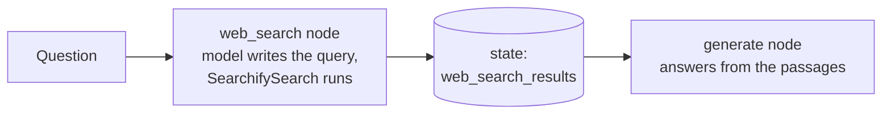

<p align="center">
  <picture>
    <source media="(prefers-color-scheme: dark)" srcset="assets/logo-dark.svg">
    
  </picture>
</p>

LangChain tools for [searchify](https://github.com/sami-mag07/searchify-l): web search, clean page text and local reranking, with no paid search API or API key.

| Tool | What the model can do with it |
|---|---|
| `SearchifySearch` | Search the web and get the most relevant passages from the top result pages, each with its source URL |
| `SearchifyExtract` | Read specific URLs and get their clean main text |

Both are standard LangChain `BaseTool`s, so they work with `bind_tools()`, `create_agent()` and LangGraph's `ToolNode`.

## Install

```bash
pip install "langchain-searchify[rerank] @ git+https://github.com/felixvew/langchain-searchify"
```

The `[rerank]` extra adds `sentence-transformers` (and PyTorch) for searchify's local cross-encoder. When it's installed, reranking is on by default; create a tool with `rerank=False` to turn it off. Without the extra the tools still work, but passages come back in page order instead of by relevance.

## Use

Call a tool directly:

```python
from langchain_searchify import SearchifyExtract, SearchifySearch

search = SearchifySearch(max_results=5, top_k=8)
search.invoke({"query": "Ballon d'Or 2026 winner"})
# {"query": "...", "results": [{"title": "...", "url": "...", "content": "...", "score": 2.36}, ...]}
```

Give the tools to an agent:

```python
from langchain.agents import create_agent

agent = create_agent(model, tools=[SearchifySearch(), SearchifyExtract()])
agent.invoke({"messages": [{"role": "user", "content": "Who won the Ballon d'Or this year?"}]})
```

Or wire them into your own LangGraph graph:

```python
from langgraph.prebuilt import ToolNode, tools_condition

tools = [SearchifySearch(), SearchifyExtract()]
model_with_tools = model.bind_tools(tools)
builder.add_node("tools", ToolNode(tools))
builder.add_conditional_edges("agent", tools_condition)
```

> [!NOTE]
> **Search with full questions, not keywords.** searchify has no search index of its own. The query goes as written to public search engines (DuckDuckGo, or the engines behind your SearXNG instance), and the same query is then used to rerank the passages. So a complete question in the user's language works better than a short keyword query. In testing, "Wer hat das ATP 500 Turnier in Basel übers Wochenende gewonnen?" put the answer first, while the keyword version "ATP 500 Basel winner 2026" ranked it third. The `query` description tells models to write full questions and to replace relative times like "this year" with the actual year, so <b>always include today's date in your system prompt</b>.

> [!IMPORTANT]
> searchify reads pages in a `spawn` process pool, on every operating system. Each worker re-imports your main script, so put your script's top-level code under `if __name__ == "__main__":`. Without the guard, that code runs again in every worker.

### What to put in the system prompt

Every model call that writes a search query or an answer needs today's date. Small models also need the time rule:

```python
SYSTEM_PROMPT = """Today's date is {today}.
If the message contains textual forms of times, like this year, always use today's date in place."""

system_message = SystemMessage(content=SYSTEM_PROMPT.format(today=date.today().isoformat()))
```

- **Writing the query:** the date and the time rule. The tool's description already tells the model how to word the query. In testing with Qwen3-8B, the date alone left "cette année" unchanged; with the time rule next to it, the model wrote the year.
- **Writing the answer:** the date as well. Without it, a model whose training data ends earlier can take this year's results for the future and say the answer isn't there.
- **Search filters:** a prompt doesn't reliably stop small models from setting filters such as `topic` or `language`, which can hide the answer. If you call the tool yourself, pass only the query: `search_tool.invoke({"query": args["query"]})`.

## Demo: LangGraph agent with a local LLM

[`examples/langchain-searchify_test.py`](examples/langchain-searchify_test.py) is a small LangGraph graph that answers questions from the web with a model you host yourself through vLLM. No API key is needed.



You need an NVIDIA GPU, Docker with GPU support (the NVIDIA Container Toolkit, or Docker Desktop with WSL 2 on Windows) and Python 3.10 or newer.

**1. Choose the model.** Create `vllm/.env` (it's gitignored):

```ini
VLLM_MODEL=Qwen/Qwen3-8B-AWQ
# Optional: only needed for gated models
HF_TOKEN=
```

Docker Compose and the example both read `VLLM_MODEL` from this file.

**2. Start vLLM.**

```bash
cd vllm
docker compose up -d
docker compose logs -f vllm
```

The first start downloads the model into the `huggingface-cache` Docker volume, which can take a while. The server is ready when the log shows `Application startup complete`. To check it, run `curl http://localhost:8001/v1/models`.

**3. Install the Python packages.**

```bash
pip install "langchain-searchify[rerank] @ git+https://github.com/felixvew/langchain-searchify" langchain langgraph langchain-openai python-dotenv
```

**4. Run the agent** from the repository root:

```bash
python examples/langchain-searchify_test.py
```

The script asks "Who won this years Ballon d'Or ?". It first prints the search arguments the model wrote, then the final state. Only the query is used for the search. The exact query and passages vary from run to run; shortened, the output looks like this:

```text
{'query': "Who won the 2026 Ballon d'Or?", 'topic': 'news', 'time_range': 'year'}
{'messages': [HumanMessage(...)],
 'web_search_results': [{'title': "2026 Ballon d'Or rankings in full ...", 'url': 'https://...', 'content': '...', 'score': 10.8}, ...],
 'generation': AIMessage(content="Harry Kane won the 2026 Ballon d'Or. ...")}
```

**How it works**

- **`web_search` node:** the model is bound to `SearchifySearch` with `tool_choice`, so it has to write a search query instead of answering from memory. The tool's description tells it to write a complete question. The node passes only that query to the search, ignoring any filters the model set, and writes the passages to `web_search_results` in the graph state.
- **`generate` node:** puts those passages into the prompt and writes the answer.
- **Today's date** is in both prompts, and the query prompt also has the time rule. Without the date, a model whose training data ends in 2023 reads "this year" as 2023: the query step searches for the wrong year, and the answer step takes this year's results for the future.

**vLLM settings the demo relies on** (in [`vllm/docker-compose.yml`](vllm/docker-compose.yml))

| Setting | Why |
|---|---|
| `--enable-auto-tool-choice`, `--tool-call-parser hermes` | Let Qwen3 make tool calls through the OpenAI-compatible API |
| `--reasoning-parser qwen3` | Keeps the model's thinking out of the answer text |
| `--max-model-len -1` | Uses as much context as fits in GPU memory. On smaller GPUs that can be only about 5,000 tokens, which is why the example uses `top_k=5, max_chars=500` |
| Port `8001:8000` | The example connects to `http://localhost:8001/v1` |

Stop the server with `docker compose down`; the downloaded model stays in the volume. Once it's downloaded, you can add `HF_HUB_OFFLINE=1` to `vllm/.env` so vLLM starts without contacting Hugging Face.

## Configuration

Settings you choose when you create a tool. The model can't change them.

| `SearchifySearch` | Default | Meaning |
|---|---|---|
| `max_results` | `5` | Search hits to look at |
| `include_page_content` | `True` | Read the result pages and return their best passages; `False` returns only search snippets |
| `top_k` | `8` | Passages to return |
| `rerank` | `None` (on if `[rerank]` is installed) | Rank passages by relevance with the local cross-encoder. `False` turns it off; `True` raises an error if the extra is missing |
| `reranker` | `None` | A loaded reranker to use instead of searchify's default model ([see below](#using-a-different-reranker)) |
| `min_words` | `12` | Shorter paragraphs are not used as passages |
| `max_chars` | `600` | Each passage or snippet is trimmed to this length |
| `backend` | `None` | `"duckduckgo"`, `"searxng"`, `"serper"` or `"tavily"`; `None` uses searchify's configured chain |

The model can also filter by `time_range`, but only with `"month"` or `"year"`. `"day"` and `"week"` are left out on purpose: small models pick them for questions about past events, such as "who won this year's award?", and the filter then hides the articles that answer the question.

| `SearchifyExtract` | Default | Meaning |
|---|---|---|
| `max_urls` | `3` | URLs read per call; the rest are reported as `skipped_urls` |
| `max_chars` | `4000` | Each page's text is trimmed to this length |
| `format` | `"text"` | `"text"` or `"markdown"` |
| `rerank` | `None` (on if `[rerank]` is installed) | When the model passes a `query`, put the matching paragraphs first. `False` turns it off |
| `reranker` | `None` | A loaded reranker to use instead of searchify's default model ([see below](#using-a-different-reranker)) |
| `timeout` | `None` | Fetch timeout per page in seconds |

Everything the tools return goes back into the model's context, so lower `top_k` and `max_chars` for models with small context windows.

### Using a different reranker

searchify picks its reranker from the `RERANKER_MODEL` variable, but some models need extra loading options, such as `trust_remote_code=True`. Load the model yourself and pass it to the tools:

```python
from sentence_transformers import CrossEncoder

reranker = CrossEncoder("Alibaba-NLP/gte-multilingual-reranker-base", trust_remote_code=True)
search = SearchifySearch(reranker=reranker)
extract = SearchifyExtract(reranker=reranker)  # both tools can share one loaded model
```

Anything with a `predict(pairs)` method that returns one score per `(query, text)` pair works.

Load the model where your app starts, for example in FastAPI's `lifespan`, or under `if __name__ == "__main__":`. At the top level of the script you run, every extraction worker would load its own copy, because the workers re-import that script.

> [!WARNING]
> `trust_remote_code=True` downloads Python code from Hugging Face and runs it on your machine, sometimes from a different repository than the model itself. Only use it for publishers you trust.

searchify itself is configured through environment variables:

| Variable | Default | Meaning |
|---|---|---|
| `SEARCH_BACKEND` | `duckduckgo` | Primary search backend |
| `SEARCH_FALLBACK` | `searxng` | Backend to try if the first finds nothing |
| `SEARXNG_URL` | | Your own SearXNG instance |
| `SERPER_API_KEY`, `TAVILY_API_KEY` | | Optional cloud fallbacks, used only if set |
| `RERANKER_MODEL` | `cross-encoder/mmarco-mMiniLMv2-L12-H384-v1` | Hugging Face name or local path of the reranker |
| `FETCH_TIMEOUT` | `15` | Page fetch timeout in seconds |

## Privacy

"No API key" doesn't mean offline. With the default setup, the model's search queries go to DuckDuckGo and the result pages are fetched from their websites. If `SERPER_API_KEY` or `TAVILY_API_KEY` is set, queries can also go to those services. Don't send confidential information in queries. To keep searches inside your own network, point `SEARCH_BACKEND` at a self-hosted SearXNG instance.

## Development

```bash
pip install -e ".[rerank]" pytest langchain-tests
pytest                          # unit tests, no network
pytest tests/integration_tests  # real searches, needs internet
```

## Why it's not on PyPI

searchify isn't on PyPI yet, and PyPI rejects packages that depend on a Git URL. Until searchify is published there, install this package from GitHub.

## Acknowledgments

A big thank you to Sami Magdouli for [searchify](https://github.com/sami-mag07/searchify-l).

I came across searchify while looking for a web search tool to test agents locally without running into the limits of hosted search APIs. It does the hard part: web search, clean page extraction and reranking, all on your own machine and without an API key. This package only adds the LangChain layer on top, so searchify can be used directly in LangChain and LangGraph agents.

The logo is adapted from searchify's logo (MIT License).

## Disclaimer

langchain-searchify is a community integration and is not affiliated with or endorsed by LangChain, Inc.

## License

This project is released under the MIT License. See [LICENSE](LICENSE).
